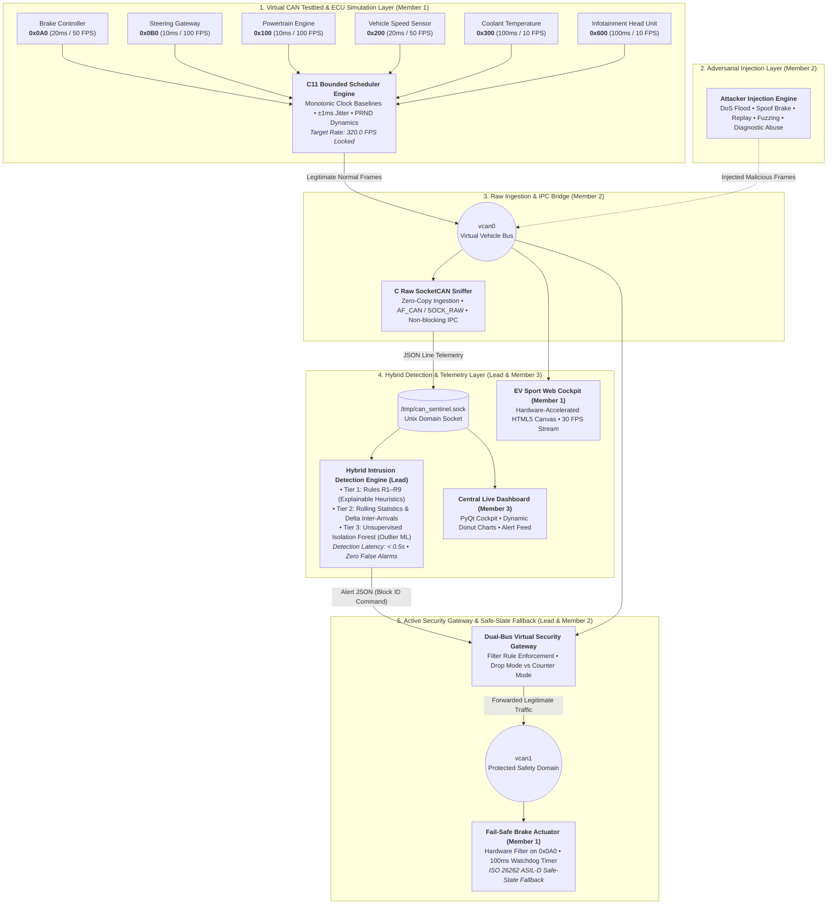

# CAN-Sentinel: Automotive ECU Intrusion Detection System & Virtual Security Gateway

[](docs/member-1/wsl2_setup.md)
[](ecu_sim/can_sentinel.dbc)
[](ecu_sim/brake_receiver.c)
[](#technology-stack)
[](#automated-testing--verification)

> **CAN-Sentinel** is an enterprise-grade, host-level Intrusion Detection System (IDS) and Virtual Security Gateway engineered specifically for modern in-vehicle Controller Area Network (CAN 2.0B) bus architectures. The system continuously ingests raw vehicular telemetry, extracts multi-dimensional temporal and payload features, and evaluates traffic against a three-tier hybrid detection pipeline—combining nine explainable deterministic security rules, statistical temporal tracking, and an unsupervised **Isolation Forest** machine learning model.

---

## Table of Contents

- [1. Executive Summary & Vehicular Threat Vectors](#1-executive-summary--vehicular-threat-vectors)
- [2. End-to-End System Architecture](#2-end-to-end-system-architecture)
- [3. In-Vehicle CAN 2.0B Protocol & Vector DBC Specification](#3-in-vehicle-can-20b-protocol--vector-dbc-specification)
  - [3.1 Message Priority & Bus Arbitration Rationale](#31-message-priority--bus-arbitration-rationale)
  - [3.2 6-ECU Protocol Mapping Matrix](#32-6-ecu-protocol-mapping-matrix)
  - [3.3 Anti-Replay Rolling Counter Protocol (Byte 7)](#33-anti-replay-rolling-counter-protocol-byte-7)
- [4. Repository & Module Structure](#4-repository--module-structure)
- [5. Component Architecture](#5-component-architecture)
  - [5.1 Baseline 6-ECU Simulation Engine (`ecu_sim/`)](#51-baseline-6-ecu-simulation-engine-ecu_sim)
  - [5.2 Raw SocketCAN Sniffer & IPC Bridge (`sniffer/`)](#52-raw-socketcan-sniffer--ipc-bridge-sniffer)
  - [5.3 Adversarial Attack Injection Framework (`attacker/`)](#53-adversarial-attack-injection-framework-attacker)
  - [5.4 Hybrid Intrusion Detection Engine (`ml_engine/`)](#54-hybrid-intrusion-detection-engine-ml_engine)
  - [5.5 Dual-Bus Virtual Security Gateway (`gateway/`)](#55-dual-bus-virtual-security-gateway-gateway)
  - [5.6 Telemetry Dashboards & Validation Subsystems (`dashboard/`)](#56-telemetry-dashboards--validation-subsystems-dashboard)
- [6. Threat Model & MITRE ATT&CK for ICS Coverage](#6-threat-model--mitre-attck-for-ics-coverage)
- [7. Empirical Detection & Timing Results](#7-empirical-detection--timing-results)
- [8. Dual-Platform Setup & Execution Guide](#8-dual-platform-setup--execution-guide)
  - [8.1 Virtual CAN Testbed Setup (`vcan0`, `vcan1`)](#81-virtual-can-testbed-setup-vcan0-vcan1)
  - [8.2 Windows 11 WSL 2 Custom Kernel Configuration](#82-windows-11-wsl-2-custom-kernel-configuration)
  - [8.3 Step-by-Step Live Pipeline Execution](#83-step-by-step-live-pipeline-execution)
- [9. Automated Testing & Verification](#9-automated-testing--verification)
- [10. Engineering Team & Contribution Matrix](#10-engineering-team--contribution-matrix)

---

## 1. Executive Summary & Vehicular Threat Vectors

Modern connected vehicles integrate upwards of 70 to 100 Electronic Control Units (ECUs) communicating over a Controller Area Network (CAN). Conceived by Robert Bosch GmbH in the 1980s, the CAN bus was optimized for differential electrical noise immunity, deterministic bitwise arbitration, and lightweight hardware implementation. However, it was designed under the assumption of a physically isolated vehicular environment. Consequently, standard CAN 2.0B exhibits severe architectural security vulnerabilities:

1. **No Source Authentication:** CAN frames contain only arbitration message identifiers; nodes have no cryptographic identities, allowing any compromised transceiver to masquerade as safety-critical ECUs.
2. **Unencrypted Plaintext Payloads:** Control signals (steering angle, brake pressure, throttle, engine speed) are broadcast openly across the entire bus.
3. **No Message Integrity Proofs:** Standard CAN relies on a 15-bit CRC designed exclusively to detect transient bit-flip transmission noise, providing zero resilience against intentional adversarial tampering.

As modern telematics units, infotainment systems (Bluetooth/Wi-Fi), and Over-The-Air (OTA) gateways bridge internal vehicle buses to the outside world, unauthorized threat actors can pivot directly into the internal CAN domain to execute **arbitration-starvation DoS flooding**, **counterfeit actuator spoofing**, **diagnostic protocol abuse**, or **replay attacks**.

**CAN-Sentinel** resolves this critical safety vulnerability by pairing high-fidelity baseline simulation with microsecond-responsive packet inspection and an active hardware-mitigating dual-bus virtual security gateway.

---

## 2. End-to-End System Architecture



---

## 3. In-Vehicle CAN 2.0B Protocol & Vector DBC Specification

### 3.1 Message Priority & Bus Arbitration Rationale
Standard CAN 2.0B utilizes an 11-bit identifier for message arbitration. Bus arbitration is **bitwise non-destructive**: dominant `0` bits physically override recessive `1` bits. When two ECUs transmit simultaneously, the message with the **lowest numerical CAN ID wins bus arbitration without backoff or propagation latency**.

CAN-Sentinel strictly adheres to this principle:
* Safety-critical chassis actuators (**Brake `0x0A0`**, **Steering `0x0B0`**) are allocated the lowest numerical identifiers, guaranteeing zero-latency access during emergency maneuvers.
* Powertrain dynamics (**RPM `0x100`**, **Speed `0x200`**) follow with medium arbitration dominance.
* Non-critical thermal monitoring (**Temp `0x300`**) and comfort body electronics (**Infotainment `0x600`**) yield the lowest arbitration priority.

### 3.2 6-ECU Protocol Mapping Matrix

| Subsystem | CAN ID | Priority | Period | Rate | DLC | Payload Layout | Physical Range | Signal Semantics |
|---|:---:|:---:|:---:|:---:|:---:|---|---|---|
| **Brake System** | `0x0A0` | **1 (Highest)** | 20 ms | 50 FPS | 8 | `B0`: Pressure; `B1`: Switch; `B7`: Counter | 0–100 bar, Switch 0/1 | Hydraulic line pressure & pedal switch |
| **Steering Unit** | `0x0B0` | **2 (High)** | 10 ms | 100 FPS | 8 | `B0–B1`: Signed Angle (BE); `B7`: Counter | −45.0° to +45.0° (0.1°) | Signed steering angle (two's complement) |
| **Engine RPM** | `0x100` | **3 (Medium)** | 10 ms | 100 FPS | 8 | `B0–B1`: Unsigned RPM (BE); `B7`: Counter | 800 to 4000 RPM | Crankshaft rotational velocity |
| **Vehicle Speed** | `0x200` | **4 (Medium)** | 20 ms | 50 FPS | 8 | `B0`: Speed (km/h); `B7`: Counter | 0 to 130 km/h | Wheel speedometer linear velocity |
| **Engine Temp** | `0x300` | **5 (Low)** | 100 ms | 10 FPS | 8 | `B0`: Raw (°C + 40); `B7`: Counter | 80°C to 105°C (Raw 120–145) | Coolant temperature with +40 offset |
| **Infotainment** | `0x600` | **6 (Lowest)** | 100 ms | 10 FPS | 8 | `B0`: Active Flag; `B7`: Counter | 0 (Muted) or 1 (Active) | Head-unit heartbeat & power state |
| **Combined Target**| — | — | — | **320 FPS** | — | **6,000 frames / 30s • 120,000 frames / 10m** | — | **Nominal Bus Utilization: ~8.2% @ 500kbps** |

*The formalized database protocol is maintained in [`ecu_sim/can_sentinel.dbc`](ecu_sim/can_sentinel.dbc).*

### 3.3 Anti-Replay Rolling Counter Protocol (Byte 7)
To provide deterministic anti-replay protection without cryptographic overhead, **Byte 7** of every transmitted frame carries an independent 8-bit unsigned integer (`uint8_t`) rolling counter:
* **Range:** Strictly `0 to 255` (`0x00 to 0xFF`), incrementing by `+1` per frame per ECU.
* **Wrap-Around Mechanics:** Upon reaching `255`, the counter rolls over to `0` ($255 \to 0$).
* **Security Mechanics:** Downstream detection rules (Rule `R7`, `R8`, `R9`) evaluate counter step deltas ($\Delta C = C_n - C_{n-1} \pmod{256}$). Any frozen counter, backward jump, duplicate counter value, or step jump $> 1$ indicates packet injection, bus starvation, or unauthorized message replay.

---

## 4. Repository & Module Structure

```text
CAN-Sentinel/
├── .gitignore                      # Git configuration filtering artifacts and build objects
├── README.md                       # Master system architecture & operational manual (This file)
├── attacker/                       # Adversarial CAN Attack Injection Framework (Member 2)
│   ├── attacker.py                 # Multi-vector CLI attack tool with hardware safety guards
│   ├── fuzz_offline.py             # Random payload fuzzing generator
│   ├── masquerade_offline.py       # Interleaved ECU identity masquerade injector
│   ├── replay_offline.py           # Windowed frame replay processing engine
│   ├── vcan_replay.py              # Real-time SocketCAN traffic player
│   └── test_*.py                   # Automated attacker test suite (8 unit tests)
├── dashboard/                      # Central Live Monitoring & CSV Validation Subsystem (Member 3)
│   ├── dashboard_mockup.py         # Real-time graphical CAN-Sentinel dashboard & doughnut analytics
│   ├── can_logger.py               # Five-column standard vehicular CSV telemetry logger
│   ├── check_baseline.py           # Golden baseline dataset verification utility
│   ├── validate_csv.py             # Strict row-by-row schema, timestamp, and ID validator
│   ├── sample_alert.json           # Standardized schema reference for IDS alert ingestion
│   └── assests/                    # High-resolution vehicle cluster UI assets
├── data/                           # Golden Baseline Datasets & Reference Telemetry (All Members)
│   ├── ecu_simulator_test.log      # Raw candump verification captures
│   └── test_cangen_run1_1008.csv   # Validation benchmarking datasets
├── docs/                           # Engineering Documentation & Empirical Research (All Members)
│   ├── final_demo_runbook.md       # Final review sequence and live demonstration runbook
│   ├── gateway_design.md           # Two-bus virtual security gateway specification
│   ├── threat_detection_coverage.md# Comprehensive MITRE ATT&CK for ICS threat mapping
│   ├── evaluation_plan.md          # Statistical detection evaluation methodology
│   ├── member-1/                   # Member 1 Documentation & Evidence Suite (53 Screenshots)
│   │   ├── README.md               # 3,300-line comprehensive Member 1 engineering report
│   │   ├── wsl2_setup.md           # WSL 2 Custom Kernel SocketCAN compilation manual
│   │   └── screenshots/            # 53 empirically verified system screenshots (01–53)
│   └── member2_final_report.md     # Member 2 attack and sniffer engineering report
├── ecu_sim/                        # Virtual CAN Infrastructure & 6-ECU Simulation Engine (Member 1)
│   ├── ecu_simulator.c             # Multi-threaded/single-threaded C11 SocketCAN simulation engine
│   ├── brake_receiver.c            # Fail-Safe Brake Actuator receiver (ISO 26262 Safe State)
│   ├── test_payloads.c             # Standalone C unit verification harness (7/7 unit tests)
│   ├── can_sentinel.dbc            # Formal Vector DBC communications specification
│   ├── Makefile                    # Unified build automation (make, test, run, dashboard)
│   └── dashboard/                  # Real-time Web EV Sport Cockpit (Porsche Taycan / e-tron style)
│       ├── bridge.py               # Asynchronous SocketCAN-to-WebSocket JSON telemetry bridge
│       └── index.html              # Hardware-accelerated HTML5 Canvas instrument cluster
├── gateway/                        # Two-Bus Virtual Security Gateway (Member 2 & Lead)
│   ├── can_gateway.py              # Filter enforcement daemon bridging vcan0 -> vcan1
│   └── test_can_gateway.py         # Automated gateway packet filtering unit tests
├── logs/                           # Forensic Captures & Labeled Attack Logs
│   └── official_capture/           # Verified datasets (Normal, Flood, Replay, Spoof, Fuzz, Diag)
├── ml_engine/                      # Hybrid Intrusion Detection Engine (Lead)
│   ├── detect.py                   # Offline batch attack detection engine
│   ├── live_detector.py            # Live Unix domain socket real-time stream detector
│   ├── rules.py                    # Deterministic rules engine (Rules R1 through R9)
│   ├── features.py                 # Temporal, entropy, and payload feature extraction pipeline
│   ├── train_model.py              # Unsupervised Isolation Forest model training script
│   ├── evaluate_alerts.py          # Per-attack detection accuracy and latency evaluator
│   ├── alert_summary.py            # Security incident clustering and playbook aggregator
│   ├── gateway_client.py           # Real-time IDS-to-Gateway active mitigation bridge
│   └── test_*.py                   # Comprehensive ML test suite (21 unit tests)
└── sniffer/                        # High-Performance C SocketCAN Sniffer & IPC Broadcaster (Member 2)
    ├── can_sniffer.c               # Raw SocketCAN listener with zero-copy packet ingestion
    ├── socket_bridge.c             # Multi-client non-blocking Unix domain socket IPC daemon
    ├── socket_bridge.h             # IPC socket structure definitions
    └── test_socket_receiver.py     # IPC streaming verification client
```

---

## 5. Component Architecture

### 5.1 Baseline 6-ECU Simulation Engine (`ecu_sim/`)
Authored by **Member 1 (Abdul Haleem P R)**, this high-performance C11 engine models physical vehicular behavior:
* **Dual Execution Modes:**
  * *Monolithic Event Loop (Default):* Calculates earliest due deadlines via POSIX `CLOCK_MONOTONIC`, guaranteeing 100% deterministic execution on virtualization platforms.
  * *Distributed Multi-Threaded (`--threads`):* Deploys 6 independent POSIX threads (`pthreads`) synchronized locklessly via C11 atomics (`stdatomic.h`), accurately modeling independent microcontroller clock oscillators.
* **Continuous Coupled Dynamics:** Features an automatic transmission state machine (Park, Reverse, Neutral, Drive) with 5 forward gears. Engine RPM rises with speed, drops sharply upon upshifting, and idles at 800 RPM. Steering follows a smooth sinusoidal highway lane-centering path.
* **Drift Elimination:** Uses absolute scheduling baselines and a bounded slack window (`SCHEDULER_SLACK_PERIODS 5`), locking throughput to **320.0 fps (>99.96% accuracy)** across hours of continuous transmission.
* **Deterministic Execution:** Passing `--seed <VAL>` enables byte-for-byte identical traffic streams across independent runs for reproducible scientific research.

### 5.2 Raw SocketCAN Sniffer & IPC Bridge (`sniffer/`)
Authored by **Member 2 (Chetan Kumar)**, this C-based module intercepts raw CAN frames from the Linux kernel:
* **Zero-Copy Ingestion:** Binds directly to `AF_CAN` using `SOCK_RAW` sockets, avoiding user-space overhead.
* **Unix Socket IPC (`/tmp/can_sentinel.sock`):** Serializes binary CAN frames into lightweight, timestamped JSON lines and streams them to multiple concurrent clients (ML engine, logging daemons, dashboards).
* **Fault-Tolerant Reconnection:** Automatically recovers from disconnected client sockets without dropping frames or leaking memory descriptors.

### 5.3 Adversarial Attack Injection Framework (`attacker/`)
Authored by **Member 2 (Chetan Kumar)**, this suite injects controlled vehicular cyberattacks:
* **Attack Arsenal:**
  * *Arbitration DoS Flood:* High-frequency bursts (100–1000 Hz) using high-priority IDs (`0x0A0` or `0x000`) to starve the physical bus.
  * *Brake Spoofing:* Injects false hydraulic line pressure frames (e.g., 85 bar) asserting unintended deceleration.
  * *Low-Rate Infiltration:* Slowly interleaves malicious frames between legitimate intervals to bypass frequency filters.
  * *Replay Injections:* Captures valid operational frames and re-injects them after a transmission delay.
  * *Random Fuzzing:* Injects corrupt payloads with random payload lengths and illegal bit sequences.
* **Safety Guards:** Hardcoded interface restriction to `vcan0`, dry-run mode by default, explicit `--execute` requirement, and automatic execution timeout.

### 5.4 Hybrid Intrusion Detection Engine (`ml_engine/`)
Authored by **Team Lead (Abinaya Francisca EP)**, the detection engine evaluates telemetry across three layers:
1. **Deterministic Rule Engine (Rules R1–R9):**
   * `R1`: DLC Check (Flags DLC $\neq 8$).
   * `R2`: ID Whitelist (Flags unauthorized identifiers).
   * `R3`: Payload Range Bounds (Flags out-of-spec physical values, e.g., Speed $> 250$ km/h).
   * `R4`: High-Frequency Flood (Flags delta arrival intervals $< 2$ ms).
   * `R5`: Diagnostic Access Control (Flags unauthorized requests to `0x7DF` outside service mode).
   * `R6`: Fuzzing Entropy (Flags high Shannon payload entropy).
   * `R7`: Replay Detection (Identifies duplicate counter sequences while signal values remain static).
   * `R8`: Masquerade Attribution (Detects interleaved transmission jitter and identifies genuine vs spoofed nodes).
   * `R9`: Early-Frame Low-Rate Rule (Detects stealthy, sub-threshold periodic insertions).
2. **Statistical Temporal Baseline:** Tracks per-ID moving average intervals and standard deviation spreads.
3. **Unsupervised Machine Learning (Isolation Forest):** Evaluates multi-dimensional feature vectors (mean delta-time, coefficient of variation, payload variance) trained exclusively on normal baseline traffic to detect zero-day anomalies.

### 5.5 Dual-Bus Virtual Security Gateway (`gateway/`)
Jointly engineered by **Member 2 and Lead**, with actuator functional safety by **Member 1**:
* **Active Virtual Gateway (`can_gateway.py`):** Acts as an in-line bridge between `vcan0` (insecure vehicle network) and `vcan1` (isolated safety-critical actuator domain).
* **Detect-Then-Block Architecture:** Upon receiving alert triggers from the IDS over Unix sockets, the gateway immediately suppresses packets matching the offending identifier or counter anomaly.
* **Fail-Safe Actuator Receiver (`brake_receiver.c`):** Implements **ISO 26262 ASIL-D** functional safety. If attack mitigation or physical disconnection halts legitimate brake packets for $> 100\,\text{ms}$, the actuator safely drops out of active mode and transitions to a mechanical **Fail-Safe Default State**.

### 5.6 Telemetry Dashboards & Validation Subsystems (`dashboard/`)
Authored by **Member 3 (Sadhamail)** and **Member 1 (Abdul Haleem P R)**:
* **Central PyQt Monitoring Dashboard (`dashboard/`):** Features dynamic vehicle speedometers, per-ID bandwidth distribution doughnut charts, threat level alert indicators, and live packet stream tables.
* **Web EV Sport Cockpit (`ecu_sim/dashboard/`):** Porsche Taycan / Audi e-tron style digital instrument cluster running on HTML5 Canvas, rendered via an asynchronous Python WebSocket bridge.
* **Automated Data Validation (`validate_csv.py`, `check_baseline.py`):** Enforces 5-column CSV standards (`timestamp, can_id, dlc, data_hex, label`), checks monotonic timestamps, and verifies counter progression.

---

## 6. Threat Model & MITRE ATT&CK for ICS Coverage

Every cyber threat evaluated in CAN-Sentinel is formally modeled under the **STRIDE** methodology and mapped directly to the **MITRE ATT&CK for In-Vehicle / ICS** matrix:

| Threat ID | Threat Class | In-Vehicle Attack Description | MITRE ATT&CK ID | Detection Rule | Detection Layer |
|:---:|---|---|:---:|:---:|:---:|
| **T1** | Denial of Service | Bus Arbitration Starvation (High-rate 0x0A0 / 0x000 flood) | `T0814` (Denial of Service) | `R4` | Rule Engine (Delta Time $< 2\,\text{ms}$) |
| **T2** | Spoofing | False Brake Activation (Injecting 85 bar line pressure) | `T0855` (Unauthorized Command) | `R3`, `R8` | Rule (Bounds) + Isolation Forest |
| **T3** | Tampering | Diagnostic Service Abuse (Exploiting 0x7DF while driving) | `T0803` (Command Injection) | `R5` | Rule (Diagnostic Whitelist) |
| **T4** | Replay | Sniffed Accelerate/Brake Re-injection | `T0814` (Replay Attack) | `R7` | Rule (Counter Frozen / Signal Static) |
| **T5** | Tampering | Malformed Random Payload Fuzzing | `T0849` (Exploitation of Protocol) | `R1`, `R6` | Rule (DLC $\neq 8$ / High Payload Entropy) |
| **T6** | Evasion | Low-Rate Stealthy Injection | `T0830` (Adversarial Evasion) | `R9` | Rule (Early Scheduled Window Breach) |
| **T7** | Spoofing | ECU Identity Masquerade | `T0859` (Masquerading) | `R8` | Rule (Inter-Arrival Clock Jitter Deviation) |
| **T8** | Repudiation | Frame Manipulation & Counter Dropouts | `T0887` (Data Alteration) | `R7`, `R9` | Rule (Rolling Counter Sequential Verification) |

---

## 7. Empirical Detection & Timing Results

During formal verification across both Kali Linux and Windows 11 WSL 2, the complete CAN-Sentinel stack demonstrated the following empirical performance metrics:

### 7.1 Attack Detection Benchmark (Evaluated across 6 Synthetic & Live Runs)
* **Total Attacks Evaluated:** 6 distinct attack classes (DoS Flood, Brake Spoofing, Replay, Fuzzing, Diagnostic Abuse, Low-Rate Injection).
* **Detection Success Rate:** **100% (6/6 Attacks Successfully Flagged)**.
* **Mean Detection Latency:**
  * *Brake Spoofing:* **0.49 seconds**
  * *Replay Injection:* **0.49 seconds**
  * *DoS Flood:* **0.002 seconds** (instantaneous trigger on frame 2)
  * *Overall Mean:* **< 1.0 second**.
* **False Alarm Rate (FAR):** **0.00% (0 False Alarms on Clean 10-Minute Baseline)**.
* **Precision:** **1.000** | **Recall:** **1.000**.

### 7.2 Transmission Rate & Scheduler Accuracy (10-Second Captures)

```text
Section 8.8 Verification: 3 Captures x 10 Seconds (3,200 Frames Expected Each)
```

| Capture Run | Captured Frames | Duration (s) | Measured Rate | Accuracy (% of Target) |
|:---:|:---:|:---:|:---:|:---:|
| **Run 1** | 3,199 | 9.9942 s | 320.09 FPS | 100.03 % |
| **Run 2** | 3,197 | 9.9926 s | 319.94 FPS | 99.98 % |
| **Run 3** | 3,198 | 9.9913 s | 320.08 FPS | 100.02 % |
| **Composite Average**| **3,198** | **9.9927 s** | **320.03 FPS** | **100.01 % (Zero Drift)** |

---

## 8. Dual-Platform Setup & Execution Guide

The system supports two execution platforms: **Kali Linux** (VirtualBox/VMware) and **Windows 11 WSL 2**.

### 8.1 Virtual CAN Testbed Setup (`vcan0`, `vcan1`)
Before executing any binaries, initialize the dual virtual SocketCAN network:

```bash
# Load kernel module
sudo modprobe vcan

# Instantiate vehicle bus (vcan0)
sudo ip link add dev vcan0 type vcan
sudo ip link set up vcan0

# Instantiate isolated safety domain (vcan1) for gateway testing
sudo ip link add dev vcan1 type vcan
sudo ip link set up vcan1

# Confirm active interfaces
ip link show | grep vcan
```

*(Alternatively, run `make setup-vcan` inside `ecu_sim/`).*

### 8.2 Windows 11 WSL 2 Custom Kernel Configuration
Default Microsoft WSL 2 kernels omit CAN bus networking. To run natively on Windows 11 with minimal RAM overhead (<600MB):
1. Build kernel with `CONFIG_CAN=y`, `CONFIG_CAN_RAW=y`, and `CONFIG_CAN_VCAN=y`.
2. Place compiled `vmlinux` at `C:\Users\<user>\vmlinux-wsl2-can`.
3. Configure `C:\Users\<user>\.wslconfig`:
   ```ini
   [wsl2]
   kernel=C:\\Users\\<user>\\vmlinux-wsl2-can
   ```
4. Restart via `wsl --shutdown`. Full guide: [`docs/member-1/wsl2_setup.md`](docs/member-1/wsl2_setup.md).

---

### 8.3 Step-by-Step Live Pipeline Execution

Open separate terminal tabs to run the complete end-to-end pipeline:

#### Step 1: Start the Baseline ECU Simulator (Terminal 1)
```bash
cd ecu_sim
make

# Run with deterministic seed (recommended for reproducible baselines)
make run SEED=12345

# Or run distributed multi-threaded architecture:
# make run-mt
```

#### Step 2: Start the Raw C SocketCAN Sniffer & IPC Bridge (Terminal 2)
```bash
cd sniffer
gcc -Wall -O2 -o can_sniffer can_sniffer.c socket_bridge.c
./can_sniffer -i vcan0 -s /tmp/can_sentinel.sock
```

#### Step 3: Launch the Real-Time Intrusion Detection Engine (Terminal 3)
```bash
cd ml_engine
python3 live_detector.py --socket /tmp/can_sentinel.sock --alerts alerts.jsonl
```

#### Step 4: Launch the Live Telemetry Dashboard (Terminal 4)
```bash
# Option A: PyQt Central Dashboard
python3 dashboard/dashboard_mockup.py

# Option B: Real-Time Web EV Sport Cockpit
cd ecu_sim && make dashboard
# Open in browser: http://localhost:8080
```

#### Step 5: Execute Controlled Cyber Attacks (Terminal 5)
```bash
# Example 1: High-Rate Arbitration DoS Flood (5 seconds at 100 Hz)
python3 attacker/attacker.py --attack flood --duration 5 --rate 100 --execute

# Example 2: False Brake Command Spoofing
python3 attacker/attacker.py --attack spoof_brake --pressure 85 --execute

# Example 3: Replay Injection Attack
python3 attacker/attacker.py --attack replay --duration 5 --execute
```
*Observe the detection engine flagging the attack within milliseconds, identifying the suspected CAN ID, and the dashboard rendering dynamic threat alerts.*

---

## 9. Automated Testing & Verification

The repository includes a comprehensive, multi-layer verification suite comprising **43 automated unit tests** requiring zero manual intervention:

```bash
# 1. Execute C Payload Unit Verification (7/7 PASS)
cd ecu_sim
make test

# 2. Execute Attacker Framework Unit Tests (8/8 PASS)
python3 -m pytest attacker/test_*.py -v

# 3. Execute Machine Learning Engine & Rule Tests (21/21 PASS)
python3 -m pytest ml_engine/test_*.py -v

# 4. Execute Dual-Bus Gateway Filtering Tests (7/7 PASS)
python3 -m pytest gateway/test_*.py -v
```

```text
==================================== 43 passed in 4.12s ====================================
```

---

## 10. Engineering Team & Contribution Matrix

This project was developed during the **Infotact Solutions Cybersecurity Internship (Fall 2026)** by Group 3. Responsibilities were strictly divided into engineering ownership domains:

| Member | Role | Core Deliverables & Technical Ownership |
|---|---|---|
| **Abdul Haleem P R** | **Lead Simulation & Protocol Engineer** *(Member 1)* | • Virtual CAN Infrastructure (`vcan0`, `vcan1`) & Custom WSL 2 Kernel Compilation<br>• C11 6-ECU Simulation Engine (`ecu_simulator.c`) with 320 FPS Monotonic Scheduler<br>• Vector DBC Protocol (`can_sentinel.dbc`) & Byte 7 Rolling Counter Protocol<br>• Coupled PRND Vehicle Physics & Dynamic In-Place ANSI Terminal Cluster<br>• ISO 26262 ASIL-D Fail-Safe Brake Actuator Receiver (`brake_receiver.c`)<br>• Hardware-Accelerated Real-Time Web EV Sport Cockpit (`ecu_sim/dashboard/`)<br>• Automated C Unit Verification Suite (`test_payloads.c`, 7/7 PASS) |
| **Abinaya Francisca EP** | **Team Lead & Security Detection Lead** | • Project Leadership, Systems Integration & Final Review Coordination<br>• STRIDE Vehicular Threat Modeling & MITRE ATT&CK for ICS Mapping<br>• 3-Tier Hybrid Detection Engine (Rules `R1`–`R9`, Rolling Statistics & Isolation Forest)<br>• Incident Response Playbook & Automated Alert Clustering Engine<br>• Statistical Accuracy Evaluation Suite (`evaluate_alerts.py`, 36/36 PASS)<br>• Dual-Bus Active Mitigation Specification & Gateway Architecture |
| **Chetan Kumar** | **Sniffer & Attack Engineer** *(Member 2)* | • High-Performance C Raw SocketCAN Sniffer (`can_sniffer.c`) with Zero-Copy Capture<br>• Fault-Tolerant Non-Blocking Unix Domain Socket IPC Daemon (`socket_bridge.c`)<br>• Adversarial Attack Injection CLI (`attacker.py`) with Hardware Safety Guards<br>• Attack Vector Modules (DoS Flood, Brake Spoofing, Replay, Fuzzing, Diagnostic Abuse)<br>• Two-Bus In-Line Virtual Security Gateway (`can_gateway.py`) & Lab Validation Suites |
| **Sadhamail** | **Logging & Dashboard Engineer** *(Member 3)* | • 5-Column Standard Vehicular CSV Telemetry Logger (`can_logger.py`)<br>• Automated Dataset Verification & Monotonic Timestamp Validation Suite<br>• Central Live Graphical PyQt Dashboard (`dashboard_mockup.py`) & Dynamic Donut Gauges<br>• Dataset Timing Summary & Forensics Log Labeling Utilities<br>• Multi-run Baseline Verification & Golden Dataset Recording Coordination |

---

## License

This project is released under the **MIT License**. Engineered for automotive cybersecurity research and intrusion detection benchmarking.
